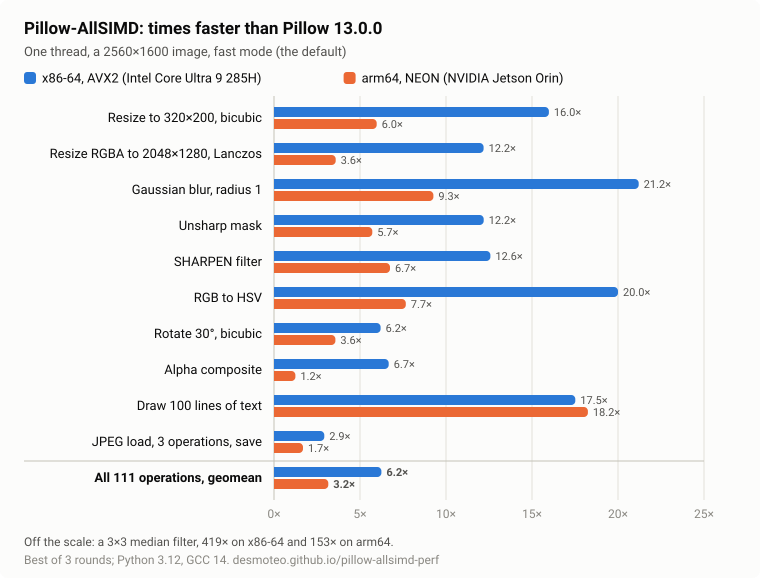

.. generated: pypi-figures (checks/simd_tables.py, pillow-allsimd-perf@392492cc3568d72691707b9cf15c7401bd712d92)

.. |fast-x86| replace:: 6.3
.. |fast-arm64| replace:: 3.3
.. |cases| replace:: 111
.. |vs-pillow-simd| replace:: 3.0
.. |opencv-cases| replace:: 104
.. |opencv-x86| replace:: 77
.. |opencv-arm64| replace:: 69
.. |exact-x86| replace:: 5.6
.. |exact-arm64| replace:: 2.7
.. |date| replace:: 2026-11-05

.. generated-end

Pillow-AllSIMD
==============

.. generated: pypi-headline (checks/simd_tables.py, pillow-allsimd-perf@392492cc3568d72691707b9cf15c7401bd712d92)

**Pillow, 6 times as fast on x86-64 and 3 times as fast on arm64.**

.. generated-end

Pillow-AllSIMD is a drop-in replacement for `Pillow <https://python-pillow.org>`_
13.0.0, the friendly PIL fork: the same ``PIL`` package and the same API, with
SIMD kernels for x86-64 (SSE4, AVX2, AVX-VNNI) and arm64 (NEON). It is a fork
of `Pillow-SIMD <https://github.com/uploadcare/pillow-simd>`_, which brought
SIMD to Pillow on x86.

         runs ten operations, and the geometric mean of all, on x86-64 with
         AVX2 and on arm64 with NEON; the numbers are in the table below.
   :target: https://desmoteo.github.io/pillow-allsimd-perf/

- **Fast**: as the geometric mean of |cases| operations on one thread,
  |fast-x86| times as fast as Pillow 13.0.0 on x86-64 with AVX2 and
  |fast-arm64| times on arm64 with NEON. That is |vs-pillow-simd| times as
  fast as Pillow-SIMD 12.1.1 with AVX2, Pillow-SIMD's last release. Of the
  |opencv-cases| operations that OpenCV 5.0 also has, Pillow-AllSIMD is faster
  in |opencv-x86| on x86-64 and in |opencv-arm64| on arm64.
- **Drop-in**: your code doesn't change. Pillow's test suite passes on every
  build.
- **Exact when you ask**: in fast mode (the default) a few operations give
  results that differ from Pillow's by a few levels at most, the same on every
  build and CPU. Exact mode follows Pillow's arithmetic and is still
  |exact-x86| times as fast on x86-64 and |exact-arm64| times on arm64.
- **arm64 too**: NEON kernels for resizes, blurs, filters, conversions,
  transforms and more, tested on an NVIDIA Jetson Orin, in wheels for Linux
  (and macOS, as they are added to this release). Other CPUs build portable
  C that compilers vectorize.
- **One x86-64 wheel for every CPU**: it holds SSE4.1, AVX2 and AVX-VNNI
  kernels and picks the best set the CPU has when Pillow loads.

Benchmarks
----------

Selected operations, one thread, a 2560×1600 RGB image. Each cell shows
Pillow 13.0.0's time, then Pillow-AllSIMD's, then the speed-up:

.. generated: pypi-benchmarks (checks/simd_tables.py, pillow-allsimd-perf@392492cc3568d72691707b9cf15c7401bd712d92)

=====================================  =========================  ========================
Operation                              x86-64, AVX2               arm64, NEON
=====================================  =========================  ========================
Resize to 320×200, bicubic             22.3 → 1.40 ms, **16.0×**  30.3 → 4.71 ms, **6.4×**
Resize RGBA to 2048×1280, Lanczos      121 → 9.87 ms, **12.3×**   145 → 36.8 ms, **4.0×**
Enlarge to 5478×3424, bicubic          226 → 27.9 ms, **8.1×**    262 → 76.6 ms, **3.4×**
Gaussian blur, radius 1                121 → 5.77 ms, **21.0×**   163 → 17.3 ms, **9.4×**
Gaussian blur, radius 10               122 → 26.3 ms, **4.6×**    165 → 91.0 ms, **1.8×**
Unsharp mask                           198 → 16.3 ms, **12.2×**   237 → 41.5 ms, **5.7×**
SHARPEN filter                         52.9 → 4.21 ms, **12.6×**  99.2 → 14.7 ms, **6.7×**
Median filter, 3×3                     1182 → 2.81 ms, **420×**   1262 → 8.27 ms, **153×**
RGB to HSV                             59.7 → 2.99 ms, **20.0×**  81.6 → 10.6 ms, **7.7×**
Unpremultiply alpha                    26.6 → 2.21 ms, **12.0×**  38.9 → 7.04 ms, **5.5×**
Rotate 30°, bicubic                    187 → 30.1 ms, **6.2×**    290 → 81.7 ms, **3.6×**
Alpha composite                        19.6 → 2.89 ms, **6.8×**   22.1 → 17.8 ms, **1.2×**
Draw 100 lines of text                 57.0 → 3.24 ms, **17.6×**  113 → 6.14 ms, **18.5×**
Decode JPEG                            16.4 → 15.6 ms, **1.0×**   28.4 → 28.7 ms, **1.0×**
Encode PNG                             792 → 156 ms, **5.1×**     1020 → 236 ms, **4.3×**
JPEG load, rotate, resize, blur, save  87.0 → 30.6 ms, **2.8×**   113 → 66.0 ms, **1.7×**
=====================================  =========================  ========================

.. generated-end

JPEG and WebP gain little: decoding and encoding them is mostly libjpeg's and
libwebp's own work. PNG saving gains because the encoder compresses with
libdeflate where it is built in, as in the wheels. The machines are an Intel Core Ultra 9 285H laptop (with
turbo off) and an NVIDIA Jetson Orin (Cortex-A78AE). Each time is the best of
3 interleaved rounds, in Docker with Python 3.12 and GCC 14, measured on
|date| on the same x86-64 and arm64 code as this release. The
`benchmark page <https://desmoteo.github.io/pillow-allsimd-perf/>`_ has all
|cases| operations, in exact and fast mode. It also compares Pillow-SIMD, OpenCV,
libvips and ImageMagick, with notes where another library's operation
differs.

Installing
----------

On Linux (glibc 2.28 or later, or musl), on x86-64 and arm64, pip installs
a wheel with the image libraries bundled, as Pillow's wheels have them. The
x86-64 wheel holds SSE4.1, AVX2 and AVX-VNNI kernels and picks the set the
CPU has when Pillow loads; the arm64 wheel has the NEON kernels. Wheels for
macOS 11 or later on Apple silicon are added to this release as GitHub's
macOS runners build them, and until then macOS builds from source, with the
NEON kernels too. Elsewhere, Pillow-AllSIMD is a source package, so pip
compiles it on installation: install the libraries
that `building Pillow from source
<https://desmoteo.github.io/pillow-allsimd/installation/building-from-source.html>`_
needs first; a source build on x86-64 holds the same three sets as the
wheel, so no option is needed. It installs the ``PIL`` package, as Pillow
does. Install your other packages first, then replace Pillow with it::

    python3 -m pip uninstall -y pillow pillow-simd
    python3 -m pip install pillow-allsimd

Uninstall Pillow before installing, not after: both own the files in
``PIL``. ``python3 -m PIL`` shows the kernels in use (``--- SIMD kernels:
avx2 (built: scalar, sse4, avx2, avxvnni)``). The ``-C simd=`` options below
apply to source builds only; to build from source on Linux anyway, add
``--no-binary pillow-allsimd``. To rebuild with another ``simd`` option, add
``--no-cache-dir --force-reinstall``. Otherwise pip reuses the wheel it built
the first time.

====================  ==============================================================
``-C simd=``          Kernels
====================  ==============================================================
``auto`` (default)    ``dispatch`` on x86-64, NEON on arm64, SSE4.1 on 32-bit
                      x86, portable C elsewhere
``dispatch``          SSE4.1, AVX2 and AVX-VNNI kernels in one build, the set
                      the CPU supports chosen when Pillow loads (x86-64; with
                      MSVC, SSE4.1 and AVX2). ``PILLOW_ALLSIMD_ISA=sse4`` (or
                      ``scalar``, ``avx2``, ``avxvnni``) caps the choice
``sse4``              SSE4.1 only, in every file; this and the next four build
                      for one set, which the CPU must have, or Pillow fails to
                      import with a message
``avx2``              SSE4.1 and AVX2: x86 CPUs since Intel Haswell and AMD
                      Excavator, except some Pentium, Celeron and Atom models
``avxvnni``           SSE4.1, AVX2 and AVX-VNNI, for faster integer filters and
                      resize: Intel Alder Lake, Sapphire Rapids and newer, AMD Zen 5
``native``            Everything the build machine's CPU supports
                      (``-march=native``); the build runs only on similar CPUs
``native512``         Like ``native``, preferring 512-bit vectors (x86)
``neon``              NEON (arm64)
``disable``           Portable C only
====================  ==============================================================

Exact and fast modes
--------------------

Fast mode is on by default. The Gaussian blur, RGB ↔ YCbCr, RGB → HSV, the
affine, perspective and quad transforms, ``rotate()``, ``blend()``, the resize
of RGB, RGBA and other 4-byte images and large downscales then use faster
kernels. Their results differ from Pillow's by a few levels at most and are
the same on every build and architecture. Exact mode follows Pillow's
arithmetic for every operation. Use it to compare pixels with images made by
Pillow::

    PILLOW_ALLSIMD_FAST=0 python3 app.py

Or, in code:

.. code-block:: python

    from PIL import Image, ImageFilter

    Image.set_fast(False)  # every operation from now on

    with Image.fast_mode(False):  # one block
        blurred = im.filter(ImageFilter.GaussianBlur(2))

`Fast mode <https://desmoteo.github.io/pillow-allsimd/reference/fast_mode.html>`_
in the documentation lists each operation and how far its results may
differ.

Testing
-------

Pillow's test suite runs on every build, and in every wheel on its own
platform. Consistency tests check each SIMD kernel against the scalar code,
and per-kernel output hashes compare the builds with each other. The
hardware tests run on x86-64 (SSE4, AVX2, AVX-VNNI) and on arm64 (NEON). The
portable build also passes the suite on riscv64, ppc64le, s390x, armv7 and
32-bit x86, under QEMU. Status: beta.

Links
-----

- `Repository and readme <https://github.com/desmoteo/pillow-allsimd>`_
- `Documentation <https://desmoteo.github.io/pillow-allsimd/>`_
- `Benchmarks <https://desmoteo.github.io/pillow-allsimd-perf/>`_
- `Changelog <https://github.com/desmoteo/pillow-allsimd/blob/simd/pillow-13/CHANGES.SIMD.rst>`_
- `Issues <https://github.com/desmoteo/pillow-allsimd/issues>`_: SIMD kernels,
  builds and fast mode. Report other bugs to
  `Pillow <https://github.com/python-pillow/Pillow/issues>`_.

Pillow is by Jeffrey 'Alex' Clark and contributors, on PIL by Fredrik Lundh
and Secret Labs AB. Pillow-SIMD is by Alexander Karpinsky and contributors,
supported by Uploadcare. All are licensed under the MIT-CMU License, and so
is Pillow-AllSIMD.
