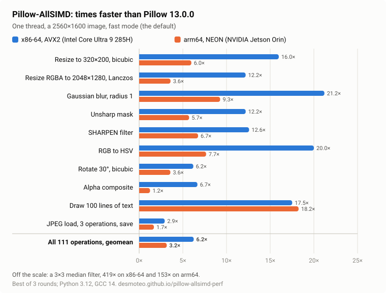

# Pillow-AllSIMD

<!-- generated: readme-headline (checks/simd_tables.py, pillow-allsimd-perf@392492cc3568d72691707b9cf15c7401bd712d92) -->

**Pillow 13, 6.3× as fast on x86-64 and 3.3× as fast on arm64**, as the geometric mean of 111 operations on one thread (5.6× and 2.7× with Pillow's exact arithmetic). That is 3.0× as fast as Pillow-SIMD, and faster than OpenCV in 77 of the 104 operations both have on x86-64, 69 on arm64.

<!-- generated-end -->

[](https://pypi.org/project/pillow-allsimd/)
[](https://pypi.org/project/pillow-allsimd/)
[](https://pypistats.org/packages/pillow-allsimd)
[][allsimd-perf-page]
[][allsimd-docs]

A drop-in replacement for [Pillow][original-homepage] 13.0.0: it installs
the same `PIL` package, with the same API, built with SIMD kernels for
x86-64 (SSE4.1, AVX2, AVX-VNNI) and arm64 (NEON). Your code doesn't change.

```bash
python3 -m pip uninstall -y pillow pillow-simd
python3 -m pip install pillow-allsimd
```

[][allsimd-perf-page]

It is a fork of [Pillow-SIMD][simd-repo], which brought SIMD to Pillow on
x86:

|                     | Pillow-AllSIMD                                                  | Pillow-SIMD 12.1.1                   |
|---------------------|-----------------------------------------------------------------|--------------------------------------|
| Based on            | Pillow 13.0.0                                                   | Pillow 12.1.1                        |
| x86-64              | SSE4.1, AVX2 and AVX-VNNI kernels, the best set chosen at import | SSE4 or AVX2, chosen when it is built |
| arm64               | NEON kernels (Linux, macOS)                                     | does not build (`-msse4`)            |
| Other CPUs          | portable C (riscv64, ppc64le, s390x, armv7)                     | does not build                       |
| Wheels on PyPI      | Linux x86-64 and arm64, CPython 3.11 to 3.15 and free-threaded  | none: compiled when installed        |

How the speed was found, and what didn't work:
[Six times Pillow: notes from Pillow-AllSIMD](https://desmoteo.github.io/pillow-allsimd/allsimd-story.html).

For Pillow itself, please refer to its
[documentation][original-docs],
[changelog][original-changelog] and
[contribution guide][original-contribute].


## Aim

- **SIMD on every common CPU.** Pillow-SIMD targets x86; Pillow-AllSIMD
  carries its kernels further on x86-64 (SSE4, AVX2, AVX-VNNI) and ports
  them to arm64 (NEON), with portable C that compilers vectorize elsewhere.
- **Fast by default.** Some operations use fast kernels whose results
  differ from Pillow's by a few documented levels at most, the same on
  every build and architecture.
- **Pillow's results when asked.** In exact mode the operations follow
  Pillow's arithmetic, or an integer form of it that rounds differently by
  one level at most in a few places, and every SIMD kernel is checked
  against the scalar code on every build.
- **Following Pillow.** Each Pillow release is merged, and changes that
  suit Pillow-SIMD are offered to it.


## State

- Version 13.0.0.post4, on Pillow 13.0.0 (the `simd/pillow-13` branch).
- Beta. On PyPI as wheels for Linux on x86-64 and arm64 (macOS to follow,
  when GitHub's macOS runners build them), and as a source package,
  compiled on installation, everywhere else (below).
- Tested on x86-64 (Intel Core Ultra 9 285H) and arm64 (NVIDIA Jetson
  Orin): Pillow's test suite on every build (scalar, SSE4, AVX2, NEON),
  the SIMD consistency tests and per-kernel output hashes that compare the
  builds (`checks/simd_hashes.py`). The portable build also passes the
  suite on riscv64, ppc64le, s390x, armv7 and 32-bit x86, under QEMU
  ([OTHER_ARCHITECTURES.md](design/OTHER_ARCHITECTURES.md)).
- [API documentation][allsimd-docs] (Pillow's, with this fork's additions)
  and [benchmarks][allsimd-perf-page] against Pillow, Pillow-SIMD, OpenCV,
  libvips and ImageMagick.


## Credits

Pillow-AllSIMD stands on the work of others, and keeps their copyright
notices ([LICENSE](LICENSE)):

- **PIL**, the Python Imaging Library, by Fredrik Lundh and contributors
  (Secret Labs AB, 1995-2011).
- **[Pillow][original-repo]**, the friendly PIL fork, by Jeffrey 'Alex'
  Clark and contributors (2010-): the library as a whole, its tests and its
  documentation, from which this fork's documentation is built.
- **[Pillow-SIMD][simd-repo]**, by Alexander Karpinsky and contributors,
  supported by [Uploadcare][uploadcare.com], which has run it in production
  since 2015: the SIMD resampling, blur, filter, conversion and composition
  kernels for x86 that this fork starts from, and the idea of a drop-in
  SIMD build.

Pillow-AllSIMD's own changes are by Matteo Ferrabone and contributors.
To cite it, see [CITATION.cff](CITATION.cff), which also cites Pillow and
Pillow-SIMD.


## Why SIMD

(From Pillow-SIMD's readme, like the "why" sections further down.)

There are multiple ways to tweak image processing performance.
To name a few, such ways can be: utilizing better algorithms, optimizing existing implementations,
using more processing power and/or resources.
One of the great examples of using a more efficient algorithm is [replacing][gaussian-blur-changes]
a convolution-based Gaussian blur with a sequential-box one.

Such examples are rather rare, though. It is also known, that certain processes might be optimized
by using parallel processing to run the respective routines.
But a more practical key to optimizations might be making things work faster
using the resources at hand. For instance, SIMD computing might be the case.

SIMD stands for "single instruction, multiple data" and its essence is
in performing the same operation on multiple data points simultaneously
by using multiple processing elements.
Common CPU SIMD instruction sets are MMX, SSE-SSE4, AVX, AVX2, AVX512, NEON.

Pillow-AllSIMD can be [compiled](#installation) with SSE4 (default on x86), AVX2, AVX-VNNI or NEON (default on arm64) support, or for the build machine's own CPU.


## What is accelerated

The following image operations are currently SIMD-accelerated:

- Resize (convolution-based resampling), including L images: SSE4, AVX2, AVX-VNNI, NEON;
  F, I and I;16 images in vectors of doubles: SSE4, AVX2, NEON
- Reduce: SSE4 (any factor), NEON (horizontal factors up to 512, and 4x4); 2x2 and 4x4 for L images on both
- Gaussian and box blur: running sums in SSE4, AVX2 (two rows at a time) and
  NEON for the horizontal pass, SSE4 and AVX2 for the vertical pass (L images
  four rows at a time on SSE4, eight on AVX2); radii below 2 and integer radii
  up to 4 without running sums: SSE4, AVX2, NEON. The vertical passes of a
  Gaussian blur run in one sweep down the image
- Unsharp mask: SSE4, NEON
- Alpha composition: SSE4, AVX2, NEON
- RGBA → RGBa (alpha premultiplication): SSE4, AVX2, NEON
- RGBa → RGBA (division by alpha): SSE4, AVX2, NEON
- RGB → L, LA and I, RGBA → LA (grayscale): SSE4, NEON
- L → RGB, RGB ↔ RGBA, RGB → CMYK: NEON (portable C that compilers vectorize
  elsewhere)
- RGB → HSV: SSE4, AVX2, NEON
- RGB ↔ YCbCr: SSE4, AVX2, NEON
- 3x3 and 5x5 kernel filters with integer kernels (exact in 16-bit fixed point,
  at the highest precision that keeps them exact): SSE4, AVX2, AVX-VNNI, NEON
- 3x3 and 5x5 kernel filters with float kernels (large coefficients): SSE4,
  AVX2 (3x3 only), NEON on 4-byte images; SSE4, AVX2 (3x3 only) on L images
- Rotate and transforms with bilinear and bicubic filters, 3- and 4-band
  images: SSE4, AVX2, NEON; every architecture transforms in cache-friendly tiles
- Transposes, 90 and 270 degree rotations, flips and 180 degree rotation:
  SSE4, NEON
- 3D color lookup tables: SSE4, AVX2, NEON
- `ImageChops.multiply` and `screen`, and `add` and `subtract` with scale 1
  and offset 0: SSE4, AVX2, NEON
- Rank filters on 1- and 4-byte images: median 3x3 and 5x5 in registers, min
  and max of any size in one pass: SSE4, AVX2, NEON; other ranks up to 11x11
  through sorting networks in portable C that compilers vectorize
- `point()` tables that are byte operations (invert, posterize, solarize):
  SSE4, AVX2, NEON
- Palette mapping (quantize, convert to an adaptive palette), nearest-entry
  search: SSE4, AVX2, NEON
- ImageDraw span fill and RGBA ink blend: SSE4, AVX2, NEON; masked fills for
  text and `bitmap()`: SSE4, NEON
- PNG encoding row filters: SSE4, NEON
- RGB pack and unpack (`frombytes`, `tobytes`, codecs): SSE4, NEON
- Split and get_channel: SSE4, NEON; merge: NEON

On arm64, alpha composition and the vertical running-sum blur pass use the
portable C code, which GCC vectorizes better than hand-written NEON on a
Cortex-A78AE.
For the horizontal blur of 4-byte images and the unsharp mask row, NEON is
faster with GCC 12 and 14 (not with GCC 11).
The mode filter, histograms, `ImageChops.offset`, floodfill, polygon fills
and text rendering (per-font caches of glyphs and advances) have faster
portable C code on every architecture.
Other architectures build the portable C code (tested on riscv64, ppc64le,
s390x, armv7 and 32-bit x86: [OTHER_ARCHITECTURES.md](design/OTHER_ARCHITECTURES.md)).


## Exact and fast modes

Fast mode is on by default: some operations use faster kernels whose
results differ from Pillow's by a few levels at most and are the same on
every build and architecture (so far the Gaussian blur,
<!-- generated: readme-gaussian-fast (checks/simd_tables.py, pillow-allsimd-perf@392492cc3568d72691707b9cf15c7401bd712d92) -->3.0x at radius 1 on x86-64, 3.1x on arm64<!-- generated-end -->,
RGB ↔ YCbCr, RGB → HSV, the affine, perspective and quad transforms and
rotate(), blend(), resize() of RGB, RGBA and other 4-byte images, and
large downscales). The other operations follow
Pillow's arithmetic, or an integer form of it that rounds differently by
one level at most in a few places (resize, RGB → L). Exact mode, with
`PILLOW_ALLSIMD_FAST=0` or `Image.set_fast(False)`, does that for every
operation: use it to compare pixels with images made by Pillow, or to
cache images by their content across versions. The
[benchmark page][allsimd-perf-page] shows the
AVX2 and NEON builds in both modes. See the
[fast mode reference](https://desmoteo.github.io/pillow-allsimd/reference/fast_mode.html)
in the [API documentation][allsimd-docs] of this
branch, and [SIMD_FAST_KERNELS.md](design/SIMD_FAST_KERNELS.md).


## Design documents

Notes on the SIMD work, in [design/](design/), kept with the code they
describe:

- [X86_SIMD_ASSESSMENT.md](design/X86_SIMD_ASSESSMENT.md),
  [ARM64_SIMD_ASSESSMENT.md](design/ARM64_SIMD_ASSESSMENT.md) and
  [ACCELERATION_OPTIONS_ASSESSMENT.md](design/ACCELERATION_OPTIONS_ASSESSMENT.md):
  the starting assessments of the x86 kernels, the arm64 port and other
  acceleration options.
- [UPSTREAM_13_REVIEW.md](design/UPSTREAM_13_REVIEW.md): Pillow 12.3 and 13.0 as a
  source of fixes and optimizations.
- [CALLGRIND_PROFILE.md](design/CALLGRIND_PROFILE.md),
  [PROFILE_ASSESSMENT.md](design/PROFILE_ASSESSMENT.md) and
  [PROFILE_TABLES.md](design/PROFILE_TABLES.md): where the time goes, from
  instruction counts, cache misses and timings over the whole API.
- [PERFORMANCE_GAPS.md](design/PERFORMANCE_GAPS.md): where OpenCV and libvips are
  still faster, and why.
- [OTHER_LIBRARIES_KERNELS.md](design/OTHER_LIBRARIES_KERNELS.md): how OpenCV,
  KleidiCV, Carotene and libvips implement those kernels, approximate ones
  included, measured for speed and accuracy.
- [APPROXIMATE_KERNELS_PLAN.md](design/APPROXIMATE_KERNELS_PLAN.md): the plan of
  fast mode, approximate kernels beside the exact ones, chosen at run time
  (opt-in in the plan, on by default now).
- [SIMD_FAST_KERNELS.md](design/SIMD_FAST_KERNELS.md): the fast-mode kernels, how
  each keeps its results the same on every build, their accuracy and speed.
- [OTHER_ARCHITECTURES.md](design/OTHER_ARCHITECTURES.md): RISC-V, POWER, s390x,
  32-bit ARM and x86: the upstream requests, the RISC-V vector pull request,
  and the portable builds tested on each.
- [PLAN.md](design/PLAN.md): the plan for PyPI releases and issue
  reports, and the open points, as a checklist.
- [REVIEW_2026-11.md](design/REVIEW_2026-11.md): the review of
  2026-11-03 (code, documentation, process) and its findings, as a
  checklist.
- [SIMD_EXPLAINER_PLAN.md](design/SIMD_EXPLAINER_PLAN.md): the outline of a detailed
  explanation of every optimization on both architectures.
- [OPTIMIZATION_METHOD.md](design/OPTIMIZATION_METHOD.md): how the next
  optimization is found, made and verified, in stages, with the fork's
  tools mapped onto each stage and the tooling left out.
- [BASELINE_2026-11-04.md](design/BASELINE_2026-11-04.md): tests,
  timings, hardware counters and the full-API profile of the branch
  after the dispatch build, and what they suggest for the next round.
- [PROFILE_FOLLOWUP_PLAN.md](design/PROFILE_FOLLOWUP_PLAN.md): that
  round: libdeflate for PNG saving, the masked histogram, the quantizer's
  hash table, the 3x3 mode filter kernel, the dithers two rows at a time,
  each measured and verified pixel for pixel.
- [NEON_ROUND_2026-11-04.md](design/NEON_ROUND_2026-11-04.md): the arm64
  assessment of the above on a Jetson Orin, the drawing regression it
  found and its fix, the kernel filters with small coefficients, and
  the changes that measured slower and were dropped.
- [ROUND_2026-11-05_PLAN.md](design/ROUND_2026-11-05_PLAN.md): eight
  items and what came of each: the wheel build measured against a
  single-tier build and the loops that differed, an instruction-count
  gate in CI, PNG decoding with libdeflate, the fast octree from the
  image's rows, the box blur's zero far weight, the NEON colour LUT and
  resampling loops, and what the profiles of drawing and of the
  Cortex-A78's unstable cases showed instead of what was expected.


## Benchmarks

Results for this version are on the [benchmark page][allsimd-perf-page]:
x86-64 (SSE4, AVX2, AVX-VNNI) and arm64 (NEON), exact and fast mode,
against Pillow 13.0, the last Pillow-SIMD release, OpenCV, libvips and
ImageMagick, over 111 operations, each library single-threaded. The
benchmark ([pillow-allsimd-perf][allsimd-perf-repo]) runs in Docker on any
machine.

Pillow-SIMD's own comparisons, against Pillow, ImageMagick, Skia, OpenCV and
IPP, are on the [Pillow Performance][pillow-perf-page] page: there
Pillow-SIMD with AVX2 resized 16 to 40 times faster than ImageMagick.


## Why Pillow itself is so fast

No cheats involved. We've used identical high-quality resize and blur methods for the benchmark.
Outcomes produced by different libraries are in almost pixel-perfect agreement.
The difference in measured rates is only provided with the performance of every involved algorithm.


## Why Pillow-SIMD and Pillow-AllSIMD are even faster

Because of the SIMD computing, of course. But there's more to it:
heavy loops unrolling, specific instructions, which aren't available for scalar data types.


## Why the SIMD code isn't in the original Pillow

Well, it's not that simple. First of all, the original Pillow supports
a large number of architectures, not just x86.
But even for x86 platforms, Pillow is often distributed via precompiled binaries.
In order for us to integrate SIMD into the precompiled binaries
we'd need to execute runtime CPU capabilities checks.
To compile the code this way we need to pass the `-mavx2` option to the compiler.
But with the option included, a compiler will inject AVX instructions even
for SSE functions (i.e. interchange them) since every SSE instruction has its AVX equivalent.
So there is no easy way to compile such library, especially with setuptools.

That was Pillow-SIMD's reasoning. Pillow-AllSIMD does it: the SIMD code of
every operation sits in companion files compiled into one translation unit
per instruction set, each with its own compiler flags, and a table of
kernels chosen when Pillow loads (`design/SIMD_DISPATCH_PLAN.md`), which
is what the `dispatch` build is. The rest of the module is compiled for
plain x86-64, so one build runs on every x86-64 CPU and uses the best
kernels it has.


## Installation

On Linux (glibc 2.28 or later, or musl), on x86-64 and arm64, pip installs
a wheel from PyPI with the image libraries bundled, as Pillow's wheels have
them. The x86-64 wheel holds SSE4.1, AVX2 and AVX-VNNI kernels and picks
the set your CPU has when Pillow loads; the arm64 wheel has the NEON
kernels. Wheels for macOS 11 or later on Apple silicon follow; until then
macOS builds from source, with the NEON kernels too. Elsewhere,
Pillow-AllSIMD is a source package: pip compiles it on installation, so
install the [build prerequisites][allsimd-build-deps] for your platform
first (those of Pillow); a source build on x86-64 holds the same three
sets as the wheel, so no option is needed. It installs the `PIL` package,
like Pillow, so install your other packages first, then replace Pillow (or
Pillow-SIMD) with it:

```bash
python3 -m pip uninstall -y pillow pillow-simd
python3 -m pip install pillow-allsimd
```

`python3 -m PIL` shows the kernels in use (`--- SIMD kernels: avx2 (built:
scalar, sse4, avx2, avxvnni)`). To build from source on Linux anyway (for
another `simd` option, or to link the system's libraries), add
`--no-binary pillow-allsimd`.

- Uninstall Pillow before installing, not after: both own the files in
  `PIL`, so removing Pillow afterwards deletes Pillow-AllSIMD's files too.
- A package that depends on `pillow` makes pip reinstall Pillow over it;
  installing that package with `--no-deps`, or installing it first, avoids
  that. `pip check` then reports Pillow as missing, which is expected.
- To rebuild with another `simd` option, add `--no-cache-dir
  --force-reinstall`: otherwise pip reuses the wheel it built the first time.
- The development branch installs with
  `"pillow-allsimd @ git+https://github.com/desmoteo/pillow-allsimd@simd/pillow-13"`
  in place of `pillow-allsimd`.

The `simd` build option chooses the instruction sets of a source build
(`-C simd=...`):

- `auto` (default): `dispatch` on x86-64, NEON on arm64, SSE4.1 on 32-bit
  x86, portable C elsewhere.
- `dispatch`: SSE4.1, AVX2 and AVX-VNNI kernels in one build, the set the
  CPU supports chosen when Pillow loads (x86-64 only; with MSVC, SSE4.1 and
  AVX2). The `PILLOW_ALLSIMD_ISA` environment variable (`scalar`, `sse4`,
  `avx2`, `avxvnni`) caps the choice, to compare the tiers on one machine.
- `sse4`: SSE4.1 only, in every file (x86 only). This and `avx2`,
  `avxvnni`, `native` and `native512` build for one instruction set, which
  the CPU must have, or Pillow fails to import with a message.
- `avx2`: SSE4.1 and AVX2 (x86 only).
- `avxvnni`: SSE4.1, AVX2 and AVX-VNNI (x86 only: Intel Alder Lake,
  Sapphire Rapids and newer, AMD Zen 5). Faster integer filters and resize.
- `native`: everything the build machine's CPU supports (`-march=native`;
  `-mcpu=native` on POWER), including AVX-512 in compiler-generated code.
  Only runs on similar CPUs. Not for RISC-V, where GCC has no native
  option: use `CC="cc -march=rv64gcv"` for the vector extension.
- `native512`: like `native`, with 512-bit vectors preferred (x86 only).
- `neon`: NEON (arm64 only).
- `disable`: portable C code only, on any architecture.

Defining the `CC` variable (`CC="cc -mavx2"`) also works.
Don't use `CFLAGS` for this: setting it replaces Python's default
compiler flags, including the optimization level.


## Contributing

Pillow-AllSIMD and Pillow are separate projects. Please report bugs and
improvements that aren't about the SIMD code or fast mode to
[Pillow][original-issues]; Pillow's fixes reach Pillow-AllSIMD with each
merged release. Issues with the SIMD kernels, the builds or fast mode belong
in this project's [issues][allsimd-issues].


## License

The MIT-CMU License, like PIL, Pillow and Pillow-SIMD: see [LICENSE](LICENSE).


  [original-homepage]: https://python-pillow.org/
  [original-repo]: https://github.com/python-pillow/Pillow
  [simd-repo]: https://github.com/uploadcare/pillow-simd
  [allsimd-docs]: https://desmoteo.github.io/pillow-allsimd/
  [allsimd-build-deps]: https://desmoteo.github.io/pillow-allsimd/installation/building-from-source.html
  [allsimd-issues]: https://github.com/desmoteo/pillow-allsimd/issues
  [allsimd-perf-page]: https://desmoteo.github.io/pillow-allsimd-perf/
  [allsimd-perf-repo]: https://github.com/desmoteo/pillow-allsimd-perf
  [original-docs]: https://pillow.readthedocs.io/
  [original-issues]: https://github.com/python-pillow/Pillow/issues/new
  [original-changelog]: https://github.com/python-pillow/Pillow/blob/master/CHANGES.rst
  [original-contribute]: https://github.com/python-pillow/Pillow/blob/master/.github/CONTRIBUTING.md
  [gaussian-blur-changes]: https://pillow.readthedocs.io/en/stable/releasenotes/2.7.0.html#gaussian-blur-and-unsharp-mask
  [pillow-perf-page]: https://python-pillow.github.io/pillow-perf/
  [pillow-perf-repo]: https://github.com/python-pillow/pillow-perf
  [uploadcare.com]: https://uploadcare.com/?utm_source=github&utm_medium=description&utm_campaign=pillow-simd
